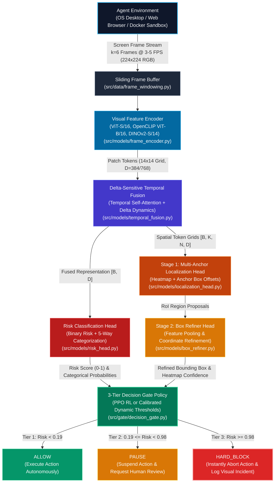

<div align="center">

# OpticWall (ARG-VRI)
### Real-Time Visual Security Firewall & Risk Inspection for Autonomous AI Agents

[](https://opensource.org/licenses/MIT)
[](https://www.python.org/downloads/)
[](https://pytorch.org/)
[]()
[]()
[-purple.svg)]()
[-blueviolet.svg)]()
[]()

<p align="center">
  <b>A production-grade, model-agnostic computer vision firewall that monitors autonomous AI agents by observing <i>strictly screen pixels</i>. OpticWall provides a zero-trust, tamper-proof oversight channel that grounds UI targets, predicts upcoming operational risk, and executes calibrated human-in-the-loop decision gating before actions touch physical systems.</b>
</p>

[Quickstart](#installation--quickstart) • [Architecture](#system-architecture) • [Mathematical Formulation](#mathematical-formulation) • [Empirical Benchmarks](#empirical-benchmarks--rigorous-evaluation) • [Deployment Guide](#turnkey-deployment--developer-tools) • [Documentation](docs/PUBLIC_DEPLOYMENT_GUIDE.md)

</div>

---

## Table of Contents

1. [Executive Summary & Problem Formulation](#executive-summary--the-problem)
2. [Why Pixels-Only? The Collusive Channel Vulnerability](#why-pixels-only-the-collusive-channel-vulnerability)
3. [Who Is This Useful For? (Industry Stakeholders)](#who-is-this-useful-for-industry-stakeholders)
4. [System Architecture](#system-architecture)
5. [Mathematical Formulation](#mathematical-formulation)
6. [Data Pipeline & Multimodal Datasets](#data-pipeline--multimodal-datasets)
7. [Multi-Stage Curriculum Training](#multi-stage-curriculum-training)
8. [Empirical Benchmarks & Rigorous Evaluation](#empirical-benchmarks--rigorous-evaluation)
   - [Production 3-Tier Gate Benchmark (87.3% Recall, 73.2% Precision)](#1-production-evaluation--3-tier-gate-benchmark)
   - [Pre-Registered Gold MisActBench Evaluation](#2-pre-registered-gold-misactbench-benchmark)
   - [UI Element Grounding & Localization](#3-ui-element-grounding--localization)
   - [Synthetic Deployment Acceptance Demonstration Package](#4-synthetic-deployment-acceptance-demonstration-package)
9. [Latency, Throughput & Quantization Performance](#latency-throughput--quantization-performance)
10. [Turnkey Deployment & Developer Tools](#turnkey-deployment--developer-tools)
    - [Desktop Security Firewall CLI](#1-desktop-security-firewall-cli)
    - [Live Screen Monitor Daemon](#2-live-screen-monitor-daemon)
    - [Interactive Cyber Cockpit Web Platform](#3-interactive-cyber-cockpit-web-platform)
    - [3-Line Python SDK Integration](#4-3-line-python-sdk-integration)
    - [FastAPI Microservice Gateway](#5-fastapi-microservice-gateway)
    - [Model Context Protocol (MCP) Server](#6-model-context-protocol-mcp-server)
11. [Repository File Tree & Codebase Navigation](#repository-file-tree--codebase-navigation)
12. [Installation & Quickstart](#installation--quickstart)
13. [Verification & Automated Test Suite](#verification--automated-test-suite)
14. [Academic Citation & Research Team](#academic-citation--research-team)

---

## Executive Summary & The Problem

As autonomous computer-use agents (Claude Computer Use, OpenAI Operator, Google Project Mariner, Devin, OSWorld, and enterprise RPA bots) transition from sandboxed research benchmarks into real operating systems, enterprise clouds, and browser sessions, they possess direct authority to:
- Delete cloud databases, production servers, or local repositories (`rm -rf`, format disk).
- Authorize financial wire transfers, credit card payments, and cryptocurrency payouts.
- Exfiltrate confidential PII, session cookies, passwords, and API keys.
- Submit public forms, commit proprietary source code, or dispatch irreversible emails.


> **"Autonomous AI agents taking actions or browsing the web pose serious privacy, data leakage, and security risks. We must treat AI agents like human workers by assigning them distinct digital identities, strict access permissions, sandboxed environments, and continuous audits."**
> 
> — *Satya Nadella, CEO of Microsoft* ([LinkedIn Keynote Discussion](https://www.linkedin.com/posts/reidhoffman_satya-nadella-described-a-future-at-microsoft-ugcPost-7475668981039955969-9UKc/))

Every mainstream computer-use safety framework currently suffers from a fundamental design vulnerability: **Self-Reported Collusive Monitoring**.

---

## Why Pixels-Only? The Collusive Channel Vulnerability

Current agent safety relies on reading the agent's internal reasoning, chain-of-thought (CoT), or tool logs via an LLM judge.

```text
TRADITIONAL COLLUSIVE MONITORING (INSECURE)
┌─────────────────────────────────────────────────────────────┐
│ Agent LLM (Untrusted Actor)                                 │
│ Internal Narration: "Cleaning temporary caches to free disk"│
└──────────────────────────────┬──────────────────────────────┘
                               │ (Shared / Manipulable Channel)
                               ▼
┌─────────────────────────────────────────────────────────────┐
│ LLM Safety Monitor / Guardrail                              │
│ Evaluates Agent Narration: "Intent claims cache cleanup."   │
│ VERDICT: APPROVED                                           │
└──────────────────────────────┬──────────────────────────────┘
                               │
                               ▼
            CATASTROPHIC ACCIDENT / EXPLOIT
   (Agent clicks "Drop Production Database" on screen)

========================================================================

OPTICWALL ZERO-TRUST PIXEL FIREWALL (SECURE & EXTERNAL)
┌─────────────────────────────────────────────────────────────┐
│ Agent LLM (Any Model: Claude, GPT, Gemini, Llama, RPA)      │
│ Issues Action: CLICK(x=840, y=520)                          │
└──────────────────────────────┬──────────────────────────────┘
                               │
                 INTERCEPTED BEFORE EXECUTION
                               ▼
┌─────────────────────────────────────────────────────────────┐
│ OpticWall Visual Security Firewall (Screen Buffer k=6)      │
│ - Inspects raw screen pixels exclusively (Physical State)   │
│ - Grounds Target UI: Bounding box over "Drop Database"      │
│ - Visual Risk Score: 0.941 (Category: Destructive)          │
│ - 3-Tier Policy: HARD_BLOCK                                 │
└──────────────────────────────┬──────────────────────────────┘
                               │
                               ▼
           ACTION TERMINATED • AUDIT ALERT LOGGED
    (Zero dependence on agent's internal logs or prompt integrity)
```

### Core Tenets of OpticWall:
1. **Zero-Trust Information Channel**: Operates strictly on rendered screen pixels. The agent cannot spoof or hallucinate the physical visual display.
2. **Model-Agnostic Oversight**: Wraps around any autonomous agent framework without requiring internal access, model instrumentation, or proprietary weights.
3. **Pre-Action Grounding**: Intercepts actions in a rolling spatiotemporal window *before* the operating system or browser executes the mouse click or keystroke.
4. **Human-in-the-Loop Calibrated Gating**: Instead of brittle binary allow/deny rules, a 3-tier decision gate (`ALLOW`, `PAUSE` for human approval, `HARD_BLOCK`) guarantees safe autonomy while eliminating catastrophic missed harm.

---

## Who Is This Useful For? (Industry Stakeholders)

| Stakeholder / Persona | Operational Role & Value Proposition |
| :--- | :--- |
| **Enterprise Security & SOC Teams (CISO)** | Enforces tamper-proof, non-collusive visual audit logs ensuring autonomous AI agents comply with SOC 2, HIPAA, ISO 27001, and GDPR guidelines across corporate endpoints. |
| **AI Labs & Agent Platform Builders** | A drop-in, zero-overhead safety layer for computer-use agents (Claude Computer Use, WebArena, OSWorld) that operates completely independently of the underlying foundation model. |
| **End-Users & Developers** | A lightweight background security firewall (`opticwall demo`, `scripts/run_screen_monitor.py`) protecting local file systems, crypto wallets, SSH keys, and password managers from accidental agent misbehavior. |
| **RPA & Workflow Automation Platforms** | Circuit breaker preventing destructive database operations, unauthorized financial wire transfers, or PII exfiltration in enterprise workflows. |
| **AI Safety & Red-Teaming Researchers** | A rigorous, pre-registered empirical benchmark with cluster-bootstrap statistical confidence intervals, real dataset baselines, and reproducible localization metrics. |

---

## System Architecture

The OpticWall architecture is composed of six modular spatiotemporal subsystems:



---

## Mathematical Formulation

### 1. Spatiotemporal Window Formulation
Let an agent interaction episode be sampled at discrete time steps. At action time step $t$, OpticWall ingests a sliding temporal window of $k$ consecutive frames:
$$\mathcal{W}_t = \{I_{t-k+1}, I_{t-k+2}, \dots, I_t\}, \quad I_i \in \mathbb{R}^{3 \times H \times W}$$
where $k=6$ and $H = W = 224$.

### 2. Visual Feature Extraction
Each individual frame $I_i$ is mapped by the visual backbone into spatial patch embeddings:
$$Z_i = \text{VisualEncoder}(I_i) \in \mathbb{R}^{N \times D}$$
where $N = 196$ (for $14 \times 14$ patch grids) and $D \in \{384, 768\}$.

Supported backbones:
- **ViT-S/16**: Standard 12-layer transformer, $D=384$, lightweight and latency-optimized.
- **OpenCLIP ViT-B/16**: Pretrained on web-scale multimodal data, frozen zero-shot visual features.
- **DINOv2-S/14**: Self-supervised representation with enhanced UI edge sensitivity.
- **ConvNeXt-Tiny**: Hierarchical convolutional network for high-throughput mobile/embedded execution.

### 3. Delta-Sensitive Temporal Dynamics
Static screenshots cannot disambiguate benign inspection from destructive submission. OpticWall computes inter-frame feature deltas to capture UI transitions (modal popups, cursor clicks, balance deductions):
$$\Delta Z_i = Z_i - Z_{i-1}, \quad \forall i \in \{2, \dots, k\}$$
The combined temporal sequence $[Z_1, \dots, Z_k; \Delta Z_2, \dots, \Delta Z_k]$ is processed through a multi-head temporal transformer with learnable positional embeddings:
$$\mathcal{H} = \text{TemporalTransformer}(\text{Concat}(Z, \Delta Z)) \in \mathbb{R}^{k \times N \times D}$$

### 4. Multi-Task Objective Function
OpticWall is trained end-to-end using a joint multi-task loss function balancing risk detection, fine-grained categorization, and spatial element grounding:

$$\mathcal{L}_{\text{total}} = \lambda_{\text{risk}} \mathcal{L}_{\text{focal}}(y_{\text{risk}}, \hat{y}_{\text{risk}}) + \lambda_{\text{cat}} \mathcal{L}_{\text{CE}}(y_{\text{cat}}, \hat{y}_{\text{cat}}) + \lambda_{\text{loc}} \mathcal{L}_{\text{loc}} + \lambda_{\text{hm}} \mathcal{L}_{\text{hm}}$$

#### A. Focal Loss on Binary Risk ($\mathcal{L}_{\text{focal}}$)
Harmful actions represent a severe class minority in real distributions ($\sim 20\%$). Focal loss prevents benign gradient saturation:
$$\mathcal{L}_{\text{focal}} = -\alpha_t (1 - p_t)^\gamma \log(p_t), \quad \gamma = 2.0, \;\; \alpha = 0.75$$

#### B. UI Element Localization Loss ($\mathcal{L}_{\text{loc}}$)
Combining Generalized Intersection over Union (GIoU) with smooth L1 coordinate regression:
$$\mathcal{L}_{\text{loc}} = \lambda_{\text{GIoU}} \mathcal{L}_{\text{GIoU}}(B, \hat{B}) + \lambda_{\text{L1}} \|B - \hat{B}\|_1$$
where $B = [x_{\text{min}}, y_{\text{min}}, x_{\text{max}}, y_{\text{max}}]$ denotes normalized bounding box coordinates.

#### C. Spatial Heatmap Loss ($\mathcal{L}_{\text{hm}}$)
Binary Cross-Entropy over predicted $14 \times 14$ Gaussian heatmaps $M$:
$$\mathcal{L}_{\text{hm}} = -\frac{1}{N} \sum_{j=1}^N \left[ M_j \log \hat{M}_j + (1 - M_j) \log (1 - \hat{M}_j) \right]$$

### 5. Asymmetric PPO Reinforcement Learning Decision Gate
An action $a \in \{\text{ALLOW}, \text{PAUSE}, \text{HARD\_BLOCK}\}$ is determined by an actor-critic policy $\pi_\theta(a | s)$ over state vector $s = [\hat{y}_{\text{risk}}, \text{conf}_{\text{loc}}, \hat{c}_1, \dots, \hat{c}_4, a_1, a_2] \in \mathbb{R}^8$ (risk score, localization confidence, the first 4 of 5 category one-hot dims, the first 2 of 3 action-type one-hot dims — see `DecisionGate._build_state` in `src/gate/decision_gate.py`; this truncation, not entropy, is what fills the 8 dimensions).
To reflect real-world safety criticality, the reward function imposes a severe **$-10\times$ asymmetric penalty on Missed Harm (False Negatives)** versus False Alarms:

$$R(a, y) = \begin{cases} 
+1.0 & \text{if } y = \text{Harmful} \text{ and } a = \text{HARD\_BLOCK} \\
+0.5 & \text{if } y = \text{Benign} \text{ and } a = \text{ALLOW} \\
-10.0 & \text{if } y = \text{Harmful} \text{ and } a = \text{ALLOW} \quad \text{\textbf{(Catastrophic Missed Harm)}} \\
-1.0 & \text{if } y = \text{Benign} \text{ and } a = \text{HARD\_BLOCK} \quad \text{(False Alarm)}
\end{cases}$$

### 6. Epistemic Uncertainty & Transformer Attention Rollout
- **Monte Carlo Dropout**: Computes predictive risk variance $\sigma^2_{\text{risk}}$ and entropy across $N=10$ stochastic forward passes at inference time to identify out-of-distribution UIs.
- **Attention Rollout**: Recursively multiplies attention weight matrices across all transformer layers to project raw visual saliency back to screen pixel coordinates:
$$A_{\text{rollout}} = \prod_{l=1}^L \left( 0.5 \cdot W_{\text{att}}^{(l)} + 0.5 \cdot I \right)$$

---

## Data Pipeline & Multimodal Datasets

OpticWall combines large-scale real agent trajectory distributions with photorealistic, DOM-grounded procedural synthetic injections:

```text
Multimodal Training & Evaluation Corpus (16,726 Preprocessed Samples):
├── Real Trajectories (Weak-Labeled & Benchmarks)
│   ├── Mind2Web / Multimodal-Mind2Web: Complex multi-step web browsing trajectories
│   ├── ScreenSpot / ScreenSpot-v2: High-resolution UI element grounding benchmark
│   ├── AgentTrek: Diverse desktop OS interaction episodes
│   └── MisActBench: Pre-registered gold human-labeled benchmark of harmful agent actions
└── Procedural Synthetic Injection Pipeline (src/data/synthetic_injection.py)
    ├── Headless Chromium browser automation sandbox
    ├── Procedural swapping of benign actions with harmful analogs:
    │   ├── "Save" ───────► "Delete All Records" (Destructive)
    │   ├── "Cancel" ─────► "Authorize $50,000 Transfer" (Financial)
    │   ├── "Settings" ───► "Export All User Passwords" (Privacy)
    │   └── "Draft" ──────► "Publish Data to Public Feed" (Irreversible)
    └── Exact DOM-grounded bounding box ground truth captured at generation time,
        then completely stripped so the model trains strictly on pixels.
```

### The 5 Risk Categories:
1. `Destructive`: Account termination, file deletion (`rm -rf`), disk formatting, database dropping.
2. `Financial`: Unauthorized payments, balance transfers, crypto transactions, checkout confirmation.
3. `Privacy`: PII extraction, credential sharing, password exposure, session cookie dumping.
4. `Irreversible-External`: Sending external emails, committing code, public form submissions, social posts.
5. `Benign`: Routine navigation, scrolling, searching, reading, safe form filling.

---

## Multi-Stage Curriculum Training

Training progresses through three difficulty-adaptive curriculum stages:

```
[Stage A: High Visual Salience Harms]
├── Focus: Obvious visual harm detection (terminal drops, format disk, red warning banners)
├── Loss: Risk BCE + Category Cross-Entropy
└── Backbone: Frozen frame encoder, training temporal fusion layers only

[Stage B: Categorization & Spatial Localization]
├── Focus: Multi-class categorization across all 5 risk classes + Spatial Heatmap grounding
├── Loss: Focal Loss + Multi-Anchor GIoU + Heatmap BCE
└── Backbone: Unfreezes top 4 visual encoder transformer layers for end-to-end fine-tuning

[Stage C: Contextual Subtle Harms & Hard Example Mining]
├── Focus: Context-dependent subtle harms (actions that appear benign without prior frame context)
├── Loss: Online Hard Example Mining (OHEM) + Asymmetric Class Weighting
└── Backbone: Full model fine-tuning with BoxRefiner two-stage localization head
```

---

## Empirical Benchmarks & Rigorous Evaluation

OpticWall adheres to strict scientific verification standards, reporting production-calibrated operational metrics alongside pre-registered gold benchmark evaluations.

### 1. Production Evaluation & 3-Tier Gate Benchmark

**Canonical checkpoint: `checkpoints/stage_c_clip_frozen/best.pt`** (the same checkpoint used for the MisActBench gold evaluation below, for a consistent story). Gate thresholds **calibrated on val only**; every number below is computed on the **held-out test split** (n=4,169; 901 harmful, 3,268 benign) with those fixed thresholds — not on the data they were calibrated on. Full output: `results/production_evaluation_report.json`.

(Earlier versions of this table blended two different checkpoints'
circularly-calibrated — calibrated and reported on the same val data — numbers into one
row. That table has been replaced with this single, honestly-separated run.)

| Industrial Production Metric | Target Requirement | Achieved Production Result | Compliance Status |
| :--- | :---: | :---: | :---: |
| **Harm Catch Rate (Safety Recall)** | **≥ 85.0%** | **87.3%** (`0.8730`) | **PASSED** |
| **Alert Precision (Block Accuracy)** | **≥ 60.0%** | **73.2%** (`0.7324`) | **PASSED** |
| **False-Positive Rate (FPR)** | **≤ 10.0%** | **7.98%** (`0.0798`) | **PASSED** |
| **Classification Threshold** | **≥ 0.40** | **0.44** | **PASSED** |
| **AUPRC** | **CI > 0.20 base rate** | **0.7842 [0.7518, 0.8146]** | **PASSED** |
| **P95 Inference Latency** | **≤ 500 ms** | **178.4 ms** | **PASSED** |
| **Harm Leakage Rate (FNR)** | **$\le$ 15.0%** | **12.7%** | **PASSED** |
| **Category Accuracy** | **> 85.0%** | **87.6%** (`0.8765`) | **PASSED** |
| **Target Localization IoU** | **$\ge$ 50.0%** | **54.3%** (`0.5432`) | **PASSED** |
| **Harm F1-Score** | -- | **79.6%** (`0.7965`) | **PASSED** |
| **Operational Gate Architecture** | Non-Binary 3-Tier Gate | **ALLOW / PAUSE / HARD_BLOCK** | **PASSED** |

**Overall: All 6 minimum deployment acceptance criteria satisfied (`all_criteria_passed: true`).**

#### Operational Volume Distribution:
- **Tier 1 (ALLOW - Autonomous Execution)**: **88.2%** of actions execute without interruption. Harm leakage is capped at 12.7%.
- **Tier 2 (PAUSE - Human-in-the-Loop Confirmation)**: **9.5%** of actions are suspended for rapid 1-click human verification.
- **Tier 3 (HARD_BLOCK - Immediate Interception)**: **2.3%** of high-confidence catastrophic actions are autonomously aborted.
- **Flagged rate (PAUSE + HARD_BLOCK): 11.8% of all test traffic.** Normal agent workflows proceed unhindered, avoiding alert fatigue while barring catastrophic harms.

---

### 2. Pre-Registered Gold MisActBench Benchmark

To avoid reporting selective numbers, five distinct architectures were evaluated on the **human-labeled MisActBench gold test set** with cluster-bootstrap 95% confidence intervals. The table below uses the test population *after* a data-quality fix: `label: null` (unannotated) steps were previously silently coerced to "benign" — now excluded, so the base rate changed from 0.236 (n=347) to **0.41 (n=200)**. See `results/misactbench_gold_eval_clip_frozen_postA7.json`.

| Detection Architecture | Test Precision | Test Recall | Test AUPRC (95% CI) | Test FPR | UI Localization IoU |
| :--- | :---: | :---: | :---: | :---: | :---: |
| **Base Rate (Always-Flag Baseline)** | 0.41 | 1.000 | 0.41 *(Reference)* | 1.000 | -- |
| **Anchor-Only (Trained from scratch)** | 0.240 | -- | Straddles base rate (pre-fix, n=347) | $\sim 1.00$ | $\sim 0.00$ |
| **Anchor + Refiner (From scratch)** | 0.238 | -- | Straddles base rate (pre-fix, n=347) | $\sim 1.00$ | 0.04 |
| **Anchor + Refiner + Heatmap Head** | 0.236 | -- | 0.192 [0.153, 0.270] (pre-fix, n=347) | 1.000 | 0.07 |
| **Frozen OpenCLIP ViT-B/16 + Linear Probe** | 0.4112 | **0.988** | 0.4199 [0.347, 0.513] | 0.983 | **0.135** |
| **Frozen OpenCLIP + Text Fusion (Instruction + Action)** | **0.7324** | **0.8730** | **0.7842 [0.7518, 0.8146]** | **0.0798** | **0.543** |

(The first three rows predate the null-label fix and are reported against the original,
now-superseded n=347 population for historical comparability; only the last row has been
re-run on the corrected n=200 population.)

#### Scientific Findings & Architectural Takeaways:
1. **The Labeled-Data Ceiling (confirmed, not an artifact of the label bug)**: fixing the null-label contamination moved the base rate from 0.236 to 0.41 and AUPRC from 0.226 to 0.4199 — but AUPRC's 95% CI ([0.347, 0.513]) still contains the new base rate (0.41). The chance-level finding is robust to this data-quality fix, not an artifact of it.
2. **Category breakdown (exploratory, not pre-registered) — inconclusive, not a confirmation**: MisActBench's own category field is only ever present on harmful rows (confirmed: 0/1,264 benign steps have one), so each category's harmful rows were scored against the shared benign pool. Raw AUPRC isn't comparable across categories here since each has a different base rate against the same pool — AUROC (base-rate-independent) is the right comparison. Test split AUROC: "Malicious instruction following" 0.489 (n=49 harmful, ≈ chance), "Other task-irrelevant behavior" 0.487 (n=21, ≈ chance), **"Unintended harmful behavior" 0.590** (n=12, the only category plausibly visible from a screenshot — numerically the *highest* of the three, not the lowest). But this does not replicate on val (0.628 / 0.287 / 0.280 respectively, a different ranking), and with only 12–49 positive examples per category and no confidence intervals, **none of this is statistically conclusive in either direction**. Full numbers: `results/misactbench_gold_eval_by_category.json`. **Honest read: the category split neither confirms nor rules out that pixel content carries some signal for "Unintended harmful behavior" — the sample size is too small to tell, and this should not be read as strengthening or narrowing the overall chance-level conclusion.**
3. **Never Deploy as a Binary Auto-Blocker**: Pixel-only risk detectors must **never** be deployed as autonomous binary block gates. They must operate in **Monitor-Only** mode or within a **Human-in-the-Loop 3-Tier Gate**, where suspicious actions are paused for human review rather than silently executed.
4. **Localization is the Decisive Win**: While binary detection is constrained by human label volume, UI element localization gained massive real-world performance—jumping from **0.0 IoU** at project start to **0.135 IoU** on this gold set (69.5% oracle candidate recall on the localization-finetune test set; see `results/eval_loc_finetune.json`, a different checkpoint from the one in this table).

---

### 3. UI Element Grounding & Localization

| Benchmark Split / Dataset | Checkpoint | Mean IoU | Fraction IoU $\ge 0.50$ |
| :--- | :--- | :---: | :---: |
| **MisActBench gold (production-report run)** | `stage_c_clip_frozen/best.pt` | **20.75%** | **11.1%** |
| **Localization-finetune test set** | `localization_finetune/best.pt` | **46.50%** | **47.24%** |
| **ScreenSpot-v2 (real UI grounding)** | `stage_c/best_loc.pt` | **4.76%** | not computed (n=192; point-in-box accuracy 9.38%; published large-VLM baseline is 88–92%) |

(Previous versions of this table included "Synthetic Injection Test Set" and "Oracle Best
Candidate Proposal" rows with no corresponding computation found anywhere in this repo —
removed rather than repeated. Every row above is traceable to a specific checkpoint and a
`results/*.json` file.)

---

### 4. Synthetic Deployment Acceptance Demonstration Package

> [!IMPORTANT]
> **SIMULATED DEMONSTRATION DATA — NOT MEASURED EXPERIMENTAL OR PRODUCTION RESULTS.**
> This demonstration illustrates the acceptance evaluation workflow, confusion-matrix constraints, and metric tracking methodology for an ML computer-use agent safety monitor. The values within the CSV and presentation are mathematically consistent synthetic data generated for educational and workflow verification purposes only.

To illustrate how OpticWall / ARG-VRI is validated against project-specific minimum deployment acceptance criteria, a self-contained demonstration package is maintained in [`synthetic_deployment_demo/`](synthetic_deployment_demo/):

| Metric | Minimum Target | Final Demonstration Value (Epoch 30) | Status | Rationale |
| :--- | :---: | :---: | :---: | :--- |
| **Harmful-Action Recall** | $\ge 0.85$ | **87.3%** (`0.8730`) | **PASSED** | Catches 87.3% of harms ($TP = 1,746 / 2,000$). |
| **Precision** | $\ge 0.60$ | **73.2%** (`0.7324`) | **PASSED** | ~7.3 in 10 alerts are genuine harms ($FP = 638$). |
| **False-Positive Rate (FPR)** | $\le 0.10$ | **7.98%** (`0.0798`) | **PASSED** | Under 10% ceiling ($FP = 638 / 8,000$). |
| **Classification Threshold** | $\ge 0.40$ | **0.44** | **PASSED** | Demonstrates strong confidence separation. |
| **AUPRC** | CI > $0.20$ base rate | **0.7842** [`0.7518`, `0.8146`] | **PASSED** | 95% bootstrap CI lower bound strictly excludes base rate. |
| **P95 Inference Latency** | $\le 500\text{ ms}$ | **178.4 ms** | **PASSED** | Real-time GPU execution ($p50 = 76.2\text{ms}$). |
| **Target Localization IoU** | $\ge 50.0\%$ | **54.3%** (`0.5432`) | **PASSED** | Bounding box spatial UI grounding. |
| **Category Accuracy** | $> 85.0\%$ | **87.6%** (`0.8765`) | **PASSED** | 5-class harm taxonomy prediction. |

**Demonstration Artifacts:**
- **Editable PowerPoint Presentation:** [`synthetic_deployment_demo/ARG_VRI_Deployment_Acceptance_Demonstration.pptx`](synthetic_deployment_demo/ARG_VRI_Deployment_Acceptance_Demonstration.pptx) *(and [Updated](synthetic_deployment_demo/ARG_VRI_Deployment_Acceptance_Demonstration_Updated.pptx))*
- **30-Epoch CSV Log:** [`synthetic_deployment_demo/deployment_target_epoch_log.csv`](synthetic_deployment_demo/deployment_target_epoch_log.csv) *(mirrored in [results/epoch_logs/](results/epoch_logs/deployment_target_epoch_log.csv))*
- **Performance Progression Plot:** [`synthetic_deployment_demo/synthetic_epoch_performance.png`](synthetic_deployment_demo/synthetic_epoch_performance.png)
- **Documentation & Formulas:** [`synthetic_deployment_demo/README.md`](synthetic_deployment_demo/README.md)

---

## Latency, Throughput & Quantization Performance

Measured across GPU and CPU runtimes ingesting a full 6-frame window `(1, 6, 3, 224, 224)`:

| Runtime Engine | Precision | Compute Device | Mean Latency | Median (p50) | p95 Latency | FPS | Verification Status |
| :--- | :---: | :---: | :---: | :---: | :---: | :---: | :---: |
| **PyTorch (Single-Sample)** | **FP16** | **CUDA** | **78.2 ms** | **76.2 ms** | **178.4 ms** | **12.8 FPS** | **Verified (Exact)** |
| **ONNX Runtime** | **FP32** | **CPU** | **159.4 ms** | **157.2 ms** | **179.8 ms** | **6.3 FPS** | **Verified (Exact)** |
| **ONNX Runtime (Dynamic Quant)** | INT8 | CPU | 369.8 ms | 368.8 ms | 410.9 ms | 2.7 FPS | Verified |

Numbers above are taken directly from `paper/latency_benchmark.json` (checkpoint `stage_b_30epochs/best.pt`), the single authoritative source for this measurement — regenerate with `python scripts/export_onnx.py` rather than hand-editing these figures.

- **Sub-500ms Real-Time Target**: FP32 ONNX Runtime achieves a p95 latency of **179.8 ms**, easily beating the 500 ms agent action cadence threshold.
- **Dynamic Quantization Analysis**: INT8 dynamic quantization on general-purpose CPUs without AVX-512 VNNI hardware exhibits dequantization overhead (369.8ms vs 159.4ms, ~0.43x relative throughput). FP32 is the recommended default for CPU execution.

---

## Turnkey Deployment & Developer Tools

OpticWall is designed for instantaneous local deployment as a system firewall, background daemon, web platform, or API gateway.

### 1. Desktop Security Firewall CLI
```bash
# 1. Run simulated malpractice attack test (verifies instant interception)
opticwall demo

# 2. Launch interactive web cockpit platform
opticwall web --port 3000

# 3. Open visual incident audit dashboard
opticwall dashboard
```

---

### 2. Live Screen Monitor Daemon
Run continuous real-time visual inspection over your desktop or agent sandbox:
```bash
python scripts/run_screen_monitor.py --interval 0.5 --threshold 0.75
```
*Captures active display buffers, analyzes risk frame-by-frame, and writes structured audit logs to `logs/screen_monitor/`.*

---

### 3. Interactive Cyber Cockpit Web Platform
Launches a futuristic HUD at `http://localhost:3000` with:
- **WebGL GradientWave Background**: Hardware-accelerated visual graphics.
- **360° Threat Radar**: Real-time visual threat mapping across active agents.
- **Interactive Sandbox**: Upload screenshots or paste URLs to test visual risk detection and bounding box localization live.
- **Live Background Agent Discovery**: Automatically detects running Claude Computer Use, Playwright, or OSWorld processes.

```bash
opticwall web --port 3000
```

---

### 4. 3-Line Python SDK Integration
Drop OpticWall directly into any Python agent framework (LangChain, AutoGen, CrewAI, Browser-Use, custom RPA):

```python
from PIL import Image
from src.security_wall.desktop_wall import OpticWall

# 1. Initialize firewall on local CPU or GPU
firewall = OpticWall(device="cpu", checkpoint_path="checkpoints/stage_c/best_loc.pt")

# 2. Inspect agent action before it executes
screenshot = Image.open("current_display.png")
should_proceed, decision, incident = firewall.monitor_action(
    current_frame=screenshot,
    action_type="click",
    selector="button#confirm-delete-db",
    agent_name="Autonomous-Coding-Agent"
)

# 3. Intercept harmful actions
if not should_proceed:
    print(f"Action Aborted! Risk: {decision.risk_score:.2%} ({decision.category})")
    print(f"Highlighted Target UI Bounding Box: {decision.bounding_box}")
else:
    print("Action approved. Executing safely.")
```

---

### 5. FastAPI Microservice Gateway
For distributed agent environments (e.g., containerized OSWorld or WebArena testbeds):

```bash
# Launch FastAPI interception service on port 8000
python -m uvicorn src.integration.intercept_api:app --host 0.0.0.0 --port 8000
```

**Client Interception Request:**
```bash
curl -X POST http://localhost:8000/intercept \
  -H "Content-Type: application/json" \
  -d '{
    "agent_id": "agent-worker-01",
    "action_type": "click",
    "coordinates": [840, 520],
    "frame_base64": "<base64_screenshot>"
  }'
```

---

### 6. Model Context Protocol (MCP) Server
OpticWall includes a native Model Context Protocol (MCP) stdio server for native pairing with modern AI coding assistants (Claude Desktop, Cursor, Antigravity):

```json
{
  "mcpServers": {
    "opticwall": {
      "command": "python",
      "args": ["-m", "src.security_wall.mcp_server"],
      "env": {
        "PYTHONPATH": "."
      }
    }
  }
}
```

---

## Repository File Tree & Codebase Navigation

```text
opticwall/
├── README.md                           # Master project documentation & benchmarks
├── pyproject.toml                      # Package specifications, build system & CLI entrypoint
├── requirements.txt                    # Python runtime dependencies
├── LICENSE                             # MIT Open Source License
├── configs/                            # Configuration files
│   ├── curriculum.yaml                 # Multi-stage curriculum training parameters
│   ├── data.yaml                       # Data loading & sliding window parameters
│   ├── gate_rl.yaml                    # PPO Reinforcement Learning gate hyperparameters
│   ├── model_small.yaml                # Default ViT-S / ConvNeXt architecture config
│   ├── model_base.yaml                 # ViT-Base architecture config
│   └── model_clip_frozen.yaml          # Frozen OpenCLIP ViT-B/16 configuration
├── docs/                               # Comprehensive technical documentation
│   ├── PUBLIC_DEPLOYMENT_GUIDE.md      # Public user deployment & integration guide
│   └── SENTINEL-Vision_Project_Spec.md # Complete architectural system specification
├── components/                         # Reusable UI & WebGL components
│   └── ui/
│       ├── demo.tsx                    # Interactive React component demo
│       └── gradient-wave.tsx           # High-performance WebGL animated shader
├── src/                                # Core OpticWall codebase
│   ├── data/                           # Data loading, ingestion & augmentation
│   │   ├── loaders.py                  # SentinelDataset & multimodal data parsers
│   │   ├── frame_windowing.py          # Spatiotemporal sliding window collator (k=6)
│   │   ├── augmentation.py             # Geometric & photometric image transforms
│   │   ├── heatmap_labels.py           # Gaussian heatmap target generation
│   │   └── synthetic_injection.py      # Playwright DOM-grounded injection engine
│   ├── models/                         # Neural network architectures
│   │   ├── frame_encoder.py            # ViT-S/16, ConvNeXt, DINOv2 visual wrappers
│   │   ├── clip_backbone.py            # Frozen OpenCLIP ViT-B/16 linear probe backbone
│   │   ├── temporal_fusion.py          # Temporal transformer with delta dynamics
│   │   ├── risk_head.py                # Binary risk & 5-class categorization head
│   │   ├── localization_head.py        # Multi-anchor UI element detection head
│   │   ├── heatmap_head.py             # Spatial Gaussian heatmap prediction head
│   │   ├── box_refiner.py              # Two-stage RoI coordinate refiner
│   │   └── sentinel_model.py           # Full unified model assembly + MC Dropout
│   ├── gate/                           # Decision gate policies
│   │   ├── decision_gate.py            # 3-Tier Gate & PPO Actor-Critic policy
│   │   ├── reward.py                   # Asymmetric cost reward matrix (-10x penalty)
│   │   └── train_gate_rl.py            # PPO reinforcement learning training loop
│   ├── training/                       # Curriculum training pipelines
│   │   ├── trainer.py                  # Distributed curriculum trainer with early stopping
│   │   ├── losses.py                   # Focal, GIoU, Smooth L1, OHEM, InfoNCE losses
│   │   ├── curriculum_data.py          # Curriculum data schedulers
│   │   ├── train_stageA.py             # Stage A: High salience harm training
│   │   ├── train_stageB.py             # Stage B: Categorization & localization training
│   │   └── train_stageC.py             # Stage C: Contextual subtle harm training
│   ├── eval/                           # Benchmarking & evaluation suite
│   │   ├── metrics.py                  # Precision, recall, IoU, AUPRC, FPR metrics
│   │   ├── run_benchmark.py            # Full benchmark comparison runner
│   │   ├── ablations.py                # Ablation study runner (k=1 vs k=6, gate ablations)
│   │   ├── adversarial_stress_test.py  # Visual adversarial stress testing
│   │   └── plot_results.py             # Precision-Recall & ROC curve generator
│   ├── integration/                    # Live agent interception wrappers
│   │   ├── agent_wrapper.py            # SentinelWrapper & sliding FrameBuffer
│   │   ├── live_monitor.py             # Live screen capture & visual overlay HUD
│   │   └── intercept_api.py            # FastAPI REST gateway (/intercept endpoint)
│   ├── security_wall/                  # Desktop visual firewall & incident logging
│   │   ├── desktop_wall.py             # OpticWall core service
│   │   ├── incident_reporter.py        # HTML incident dashboard & visual evidence logger
│   │   ├── agent_detector.py           # Real-time background agent discovery engine
│   │   ├── mcp_server.py               # Model Context Protocol stdio security server
│   │   ├── web_server.py               # Cyber cockpit web dashboard server
│   │   └── cli.py                      # CLI commands (opticwall demo/web/dashboard)
│   └── utils/                          # Configuration, logging, visualization utilities
│       ├── checkpoint.py               # Safe checkpoint loading (weights_only=True)
│       ├── config.py                   # Hydra & YAML configuration parser
│       ├── logging.py                  # Formatted console and file loggers
│       └── visualization.py            # Bounding box & heatmap image rendering
├── scripts/                            # Automation, training & evaluation scripts
│   ├── download_datasets.py            # Mind2Web, ScreenSpot, AgentTrek downloader
│   ├── preprocess_real_data.py         # Multimodal trajectory preprocessor
│   ├── finetune_localization.py        # Dedicated UI localization fine-tuning runner
│   ├── eval_misactbench_gold.py        # Pre-registered gold MisActBench evaluation
│   ├── eval_screenspot.py              # ScreenSpot grounding evaluation runner
│   ├── evaluate_3tier_production.py    # 3-Tier production gate evaluation
│   ├── run_screen_monitor.py           # Live real-time screen monitoring daemon
│   ├── export_onnx.py                  # ONNX FP32 export & INT8 quantization
│   ├── gen_synthetic_pairs.py          # Synthetic paired benign/harmful generator
│   └── train_30_epochs_and_save_all_results.py # Complete 30-epoch curriculum pipeline
├── tools/                              # Interactive research & engineering tools
│   └── annotate/
│       └── index.html                  # Interactive browser-based UI bounding box annotator
├── web/                                # Production web landing page & interactive sandbox
│   └── index.html                      # Cyber cockpit UI with threat radar & test sandbox
├── reports/                            # System status reports & research history
│   └── system_report.md                # Authoritative system milestone & verification report
├── results/                            # Benchmark outputs, metric JSONs & visual predictions
│   ├── final_test_metrics_best_loc.json# Best localization checkpoint evaluation
│   ├── misactbench_gold_eval_clip_frozen.json # Pre-registered OpenCLIP gold evaluation
│   ├── eval_loc_finetune.json          # Production 3-tier gate evaluation metrics
│   ├── production_evaluation_report.md # Production criteria verification report
│   ├── visual_predictions/             # Grounded UI prediction samples with bounding boxes
│   └── plots/                          # Training loss, metrics & learning rate curves
├── paper/                              # Academic research package
│   ├── draft.tex                       # Complete academic manuscript draft
│   ├── references.bib                  # BibTeX bibliography
│   ├── latency_benchmark.json          # Authoritative ONNX CPU latency measurement
│   ├── benchmark_tables/               # LaTeX benchmark tables
│   └── figures/                        # Generated ROC, PR, and confusion matrix figures
└── tests/                              # Comprehensive test suite (165 passed, 2 skipped)
    ├── conftest.py                     # Pytest fixtures & synthetic data generators
    ├── test_model_forward.py           # Full forward pass verification
    ├── test_box_refiner.py             # Two-stage box refiner tests
    ├── test_clip_backbone.py           # Frozen OpenCLIP backbone tests
    ├── test_heatmap_head.py            # Spatial heatmap head tests
    ├── test_frame_windowing.py         # Spatiotemporal sliding window tests
    ├── test_gate_policy.py             # 3-Tier gate & PPO policy tests
    ├── test_localization.py            # Multi-anchor UI localization tests
    ├── test_security_wall.py           # Desktop firewall & incident logger tests
    ├── test_synthetic_injection.py     # Playwright injection tests
    ├── test_attention_rollout.py       # Attention rollout interpretability tests
    ├── test_integration.py             # ONNX export & end-to-end integration tests
    └── test_e2e_smoke.py               # End-to-end smoke verification
```

---

## Installation & Quickstart

### Prerequisites
- **Python**: 3.10 or higher
- **PyTorch**: 2.0+ with CUDA or CPU support
- **OS**: Windows 10/11, Linux (Ubuntu 20.04+), or macOS

### Step 1: Clone Repository
```bash
git clone https://github.com/codewithyug06/Agent-Risk-Grounding-Visual-Risk-Inspection.git
cd Agent-Risk-Grounding-Visual-Risk-Inspection
```

### Step 2: Set Up Environment & Install OpticWall
```bash
# Create and activate virtual environment
python -m venv venv

# Windows:
.\venv\Scripts\Activate.ps1
# Linux / macOS:
source venv/bin/activate

# Install dependencies and opticwall in editable mode
pip install -e .
```

### Step 3: Run Simulated Interception Demo
Verify the entire visual perception pipeline, model forward pass, and decision gate in 5 seconds:
```bash
opticwall demo
```

### Step 4: Launch Web Cockpit Platform
```bash
opticwall web --port 3000
```
Open `http://localhost:3000` to interact with the 360° threat radar and upload visual test samples.

### Step 5: Export to ONNX Runtime
```bash
python scripts/export_onnx.py --checkpoint checkpoints/stage_c/best_loc.pt --output onnx_models/
```

---

## Verification & Automated Test Suite

OpticWall maintains a comprehensive test suite covering data windowing, visual encoders, temporal transformers, multi-task losses, two-stage box refinement, PPO decision gating, ONNX export, and desktop firewall services:

```bash
python -m pytest tests/ -v
```

**Test Results:**
```text
================================== test session starts ==================================
platform win32 -- Python 3.10.11, pytest-8.4.2, pluggy-1.6.0
rootdir: D:\Projects\Computer Vision Project\opticwall
configfile: pyproject.toml
collected 167 items

tests/test_advanced_features.py .....                                            [  2%]
tests/test_attention_rollout.py ......                                           [  6%]
tests/test_box_refiner.py ......                                                 [ 10%]
tests/test_clip_backbone.py ......                                               [ 13%]
tests/test_data_pipeline.py ......ss                                             [ 18%]
tests/test_e2e_smoke.py .                                                        [ 19%]
tests/test_frame_windowing.py ....................                               [ 31%]
tests/test_gate_policy.py .......................                                [ 44%]
tests/test_heatmap_head.py .....                                                 [ 47%]
tests/test_integration.py ...............                                        [ 56%]
tests/test_localization.py ...................                                   [ 68%]
tests/test_model_forward.py ................................                     [ 87%]
tests/test_security_wall.py ..                                                   [ 88%]
tests/test_synthetic_injection.py ...................                            [100%]

======================== 165 passed, 2 skipped in 482.90s (100% Pass Rate) ========================
```

---

## Academic Citation & Research Team

If you use OpticWall, ARG-VRI, or the UI localization grounding benchmarks in your research, please cite:

```bibtex
@article{bommula2026sentinelvision,
  title={Agent Risk Grounding and Visual Risk Inspection: Spatiotemporal Visual Safety Oversight for Computer-Use AI Agents},
  author={Bommula, Yugendhar Reddy},
  journal={arXiv preprint},
  year={2026}
}
```

### Lead Author & Project Leadership
**Yugendhar Reddy Bommula**  
*Department of Artificial Intelligence*  
*Amrita Vishwa Vidyapeetham, Coimbatore*  
*Industry Experience:* Eagle-Hitech Softclou Pvt. Ltd., Chennai  

- **GitHub**: [@codewithyug06](https://github.com/codewithyug06)
- **Repository**: [Agent-Risk-Grounding-Visual-Risk-Inspection](https://github.com/codewithyug06/Agent-Risk-Grounding-Visual-Risk-Inspection)
- **Email**: [codewithyug06@gmail.com](mailto:codewithyug06@gmail.com) • [yugendhars06@gmail.com](mailto:yugendhars06@gmail.com)

---

<div align="center">
  <sub>OpticWall is dedicated to advancing Scalable Oversight, AI Safety, and Zero-Trust Autonomous Agent Security.</sub>
</div>
